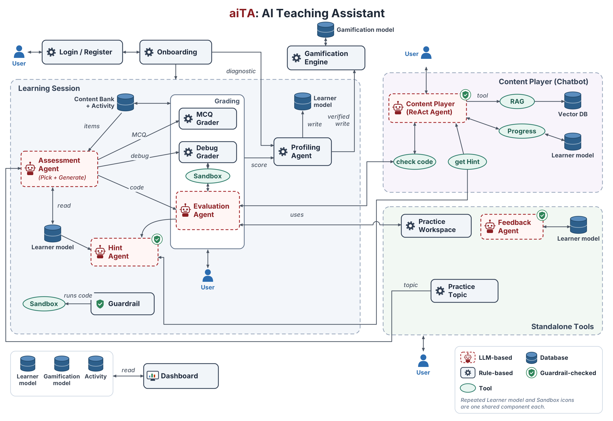

# aiTA: AI Teaching Assistant

aiTA is a practice platform for first-year programming students. Students learn in **C**,
**C++** or **Python** across 12 topics, from basics and loops to recursion and dynamic
programming. They answer questions, fix bugs and write code. Each answer moves their level
on that topic, and the level decides what they get next.

Three ideas run through the whole system:

- **Grades are verified, not guessed.** Code runs against tests in a sandbox and
  multiple-choice answers are checked against a key. Only written theory answers go to an
  LLM, which marks them against fixed key points and counts them at half weight.
- **The learner model is per topic and per language.** Being strong at loops in Python
  says nothing about loops in C, so switching language triggers a short re-check.
- **Help never gives the answer away.** Every hint passes a guardrail that runs any code in
  it against the problem's tests and blocks it if it passes.



---

## How it works

The figure has four areas. Red dashed boxes call an LLM, grey boxes are plain rules, and a
green shield marks output that passes the guardrail before the student sees it.

### 1. Getting started

A student registers and logs in with an emailed one-time code. **Onboarding** asks about
their background, learning preferences and language, then runs a short adaptive check:
predict the output, find the bug, fill the blank, write code, and three written answers.
The results give a starting level on all 12 topics.

### 2. The learning session

This is the core loop, and every answer goes through it:

1. The **Assessment Agent** reads the learner model, picks the weakest open topic and a
   difficulty, and serves an item from the content bank. If no stored coding problem fits,
   it writes a new one.
2. The answer goes to the matching **grader**:
   - the **MCQ Grader** checks the option against the key;
   - the **Debug Grader** runs the student's fix against the item's tests;
   - the **Evaluation Agent** builds a test suite for code, checks the suite against a
     reference solution, runs the submission in the sandbox, and has an LLM explain the
     result.
3. The **Profiling Agent** turns the verified score into a mastery update for that topic
   and language. A run that could not be verified, such as a compile error, adds nothing.
4. When a student is stuck, the **Hint Agent** climbs a ladder (concept, then steps, then
   a pointer to the line), grounded in their failing attempt. The **Guardrail** checks every
   hint first.

The **Gamification Engine** awards points, streaks and badges from verified events only,
so it cannot be farmed by resubmitting. The **Dashboard** reads the learner model, the
awards and recent activity.

### 3. The chatbot (Content Player)

A tutor that answers in chat and is grounded in course books. It is an agent with four
tools:

- searching the books (RAG over pgvector);
- reading the student's progress;
- checking code through the Evaluation Agent;
- asking the Hint Agent for a hint, so the same guardrail applies.

### 4. Standalone tools

- **Topic practice:** pick a topic, read a short explanation, then answer 10 questions on
  it.
- **Practice workspace:** grade any piece of code against a problem statement.
- **Feedback Agent:** reports on recent work, with errors, misconceptions and topics to
  revisit.

---

## What students see

| Page | Purpose |
|---|---|
| **Home** | Topic levels, the last session, shortcuts, and the chat panel |
| **Practice** | One adaptive question at a time (MCQ, debug or coding), ending in a session summary |
| **Topic practice** | A written explanation of one topic, then 10 questions: 3 theory, 3 MCQ, 3 debug and 1 coding problem |
| **Coding problems** | A fresh problem on any topic and level, with hints, the chatbot, and a solution that opens after passing or after "I give up" |
| **Code workspace** | Grade your own code against a problem statement |
| **Feedback** | Reports on recent work |
| **Profile** | Background, preferences, language and level on every topic |

## Content

All content exists in C, C++ and Python. Every MCQ, debug item and coding problem has been
proven by running it.

| | Count |
|---|---|
| Topic explanations | 36 (12 topics × 3 languages) |
| Coding problems | 96, each with its own tests |
| Debug challenges | 216 |
| Multiple-choice questions | 252 |
| Theory questions | 216, each with a model answer and key points |
| Onboarding check items | 120 |

---

## Tech stack

| | |
|---|---|
| **Frontend** | React 18, Vite, Tailwind CSS, CodeMirror 6 |
| **Backend** | Python 3.11, FastAPI, SQLAlchemy 2, Alembic, LangGraph |
| **Database** | PostgreSQL with pgvector |
| **LLM** | NVIDIA NIM (Nemotron models) behind one gateway with per-task models, deadlines and a fallback |
| **Code execution** | A self-hosted sandbox container with CPU, memory and process limits, on an internal network |

---

## Running locally

### Prerequisites

- Docker with Compose
- Node.js 18+ (only for running the frontend outside Docker)
- `backend/.env` with at least `DATABASE_URL`, `SECRET_KEY` and `NVIDIA_API_KEY` (see
  [Configuration](#configuration))

### 1. Start the stack

```bash
docker compose -f docker-compose.yml -f docker-compose.local.yml up -d --build
```

This starts a local Postgres on port 5433, the sandbox and the backend. Leave out the
`-f docker-compose.local.yml` part to use the database in `backend/.env` instead.

### 2. Create the schema

```bash
docker compose exec backend sh -c "cd /app/app && PYTHONPATH=/app alembic upgrade head"
```

### 3. Load the content

```bash
docker compose exec backend python -m scripts.ingest_problems
docker compose exec backend python -m scripts.seed_practice
docker compose exec backend python -m scripts.seed_theory
docker compose exec backend python -m scripts.seed_diagnostic
docker compose exec backend python -m scripts.ingest_books
```

Every script is safe to rerun.

### 4. Open it

| | |
|---|---|
| App | http://localhost:5173 |
| API docs | http://localhost:8000/docs |

Without email credentials, login codes are printed to the backend log:
`docker compose logs backend | grep "\[DEV\] OTP"`. For a one-click login during
development, set `DEV_LOGIN_EMAIL` to an existing account and keep `DEBUG=True`.

### Frontend with hot reload

```bash
cd frontend
npm install
npm run dev   # http://localhost:3000, proxies /api to the backend on :8000
```

---

## Development

### Tests

```bash
cd backend && python -m pytest -q          # SQLite, fake sandbox, no LLM calls
cd frontend && npm run lint && npm test && npm run build
```

### Project structure

```
backend/
  app/
    agents/       LangGraph agents: assessment, code evaluation, profiling, feedback, chat
    services/     grading, hints and guardrail, onboarding, topic practice, gamification, RAG
    api/          one FastAPI router per area, all under /api/v1
    data/         content banks and topic explanations
    alembic/      database migrations
  executor/       the code sandbox
  scripts/        seeding and maintenance
  tests/
frontend/src/
  pages/          one file per route
  components/     UI per feature
docs/figures/     diagrams
```

### Configuration

Settings are read from `backend/.env` (see `backend/app/core/config.py` for all of them).

| Variable | Purpose |
|---|---|
| `DATABASE_URL` | PostgreSQL with pgvector (required) |
| `SECRET_KEY` | Signs login tokens (required) |
| `NVIDIA_API_KEY`, `NVIDIA_API_KEY_2` | LLM access; the second key serves the fallback model |
| `EXECUTOR_URL` | The sandbox, `http://executor:8080` by default |
| `GAMIFICATION_MODE` | `live` (default: shown on Home and toasted after each graded answer), `silent` (recorded, shown only on request) or `off` |
| `GMAIL_*` or `SMTP_*` | Sending login codes by email |
| `DEV_LOGIN_EMAIL` | One-click development login (needs `DEBUG=True`) |

### Notes

- Alembic owns the schema, and the app never creates tables on startup. Run Alembic from
  `backend/app`, where `alembic.ini` lives.
- The theory bank files are append-only. A question's id comes from its position, and
  `seed_theory` refuses to change a question that students have already answered.
- Keep the `exec` flag on the sandbox's tmpfs mount. Without it, every compiled submission
  fails with "Permission denied".

---

## License

MIT. See [LICENSE](LICENSE).
