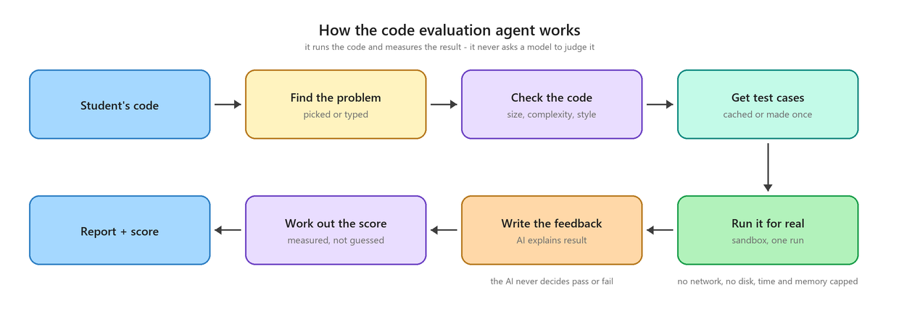

# Code Evaluation Agent

Grades a student's program by **running it**, not by asking a model whether it looks right.

Correctness is a measured pass rate. If it cannot be measured, it is reported as
`null` — never estimated.

---

## The pipeline

Six steps, run in order. It is a LangGraph `StateGraph`, compiled once and invoked
synchronously.



| Step | In the code | What it does |
|---|---|---|
| Find the problem | `route_mode` | Uses `problem_id` if the student picked from the bank, else fingerprints the statement they typed. No problem, or a language we cannot run ⇒ **review mode**. |
| Check the code | `analyse` | `lizard` static metrics — complexity, function length, LOC. No LLM. |
| Get test cases | `ensure_tests` | Loads the problem's cases. Generates them only if it has none yet. |
| Run it for real | `execute_student` | Runs the code **once** in the sandbox against every sub-case merged into one stdin, then splits the output back apart. |
| Write the feedback | `explain` | The only per-submission LLM call. Skipped entirely when the code did not compile. |
| Work out the score | `score` | Weighted score, and builds the `EvalReport` that leaves the agent. |

**Two modes.** *Verified* means the code ran against real test cases and correctness is a
real number. *Review* means it could not be — no problem statement, unrunnable language,
executor down — so correctness is `null` and its weight is dropped from the total
rather than filled with a guess.

---

## Batch input format

One run, not one run per test. Stdin starts with a test count, then that many blocks —
the shape a competitive-programming problem uses.

```
stdin          expected
─────          ────────
3        ←T    5
1 2            9
4 5            0
0 0
```

The program loops `T` times. Its single output stream is split back by line count:
sub-case *i* consumes as many lines as its expected output has. That keeps **partial
credit** — 6 of 8 sub-cases passing scores 75, not 0.

One consequence worth knowing: a stray extra line early on shifts everything after it
and fails the rest. That is genuinely wrong output, but the report flags it explicitly
so the student looks at their printing, not their logic.

Lives in `multi_test.py`.

---

## Two rules that make the grade trustworthy

**1. A test case is only stored when two independent derivations agree.**

| Source | Derivation A | Derivation B |
|---|---|---|
| Bank problem (`problems.json`) | the authored `expected_stdout` | the shipped reference solution, executed |
| Student's own problem | the LLM's predicted output | the LLM's reference solution, executed |

Disagree ⇒ the case is dropped. The stored expected output is always the **executed**
one, never the predicted one. Fewer than `TEST_CASES_MIN` survivors ⇒ the whole
evaluation falls back to review mode.

**2. The report is a projection, not the state.**

`EvalState` holds the reference solution and every expected output. `EvalReport` is
built field by field in `score.py` and carries neither. Per-sub-case rows are
pass/fail status only.

The single exception: the **first failing** sub-case is revealed in full — its input,
expected and actual output. A hint that cannot name the input teaches nothing.

---

## Scoring

```
overall = 0.55·correctness + 0.20·complexity + 0.15·efficiency + 0.10·style
```

Correctness is `100 × passed / total`. Complexity comes from `lizard`, efficiency from
the Big-O band the model reports, style from static issue counts. A `null` dimension is
removed and the remaining weights renormalised.

---

## Where the LLM is used

| Purpose | Runs when | Model |
|---|---|---|
| Feedback (`explain`) | every evaluation that compiled | NVIDIA |
| Test generation | only for a problem with no cases yet | Gemini |

Codegen stays on Gemini because every NVIDIA model on this key strips line breaks out
of code returned inside a JSON string. See `app/core/llm.py`.

**The LLM never decides whether the code is correct.** It reads the measured result and
writes about it.

---

## The sandbox

`execute_student` never runs anything in the API process. It calls the `executor`
container over HTTP (`app/services/execution/`), which compiles once and runs many.

The container drops all capabilities, mounts its filesystem read-only, sits on an
internal Docker network with no route out, and applies POSIX rlimits (CPU, address
space, process count, file size) per run.

> `docker-compose.yml` mounts `/tmp` with an explicit `exec`. Docker defaults tmpfs to
> `noexec`, which silently breaks every C++ submission. Do not remove it.

---

## Files

```
code_eval/
├── graph.py          the StateGraph and evaluate_submission()
├── state.py          EvalState — internal, never crosses a boundary
├── schemas.py        EvalReport — what does cross it
├── multi_test.py     batch merge, output split, verdicts
├── scoring.py        weights and the score formulas
├── static_metrics.py lizard wrapper and issue detection
├── prompts.py        the two prompts
└── nodes/            one file per node
```

Related: `app/services/test_generation/` (case generation), `app/services/execution/`
(sandbox client), `backend/executor/` (the sandbox itself).

---

## Running the tests

```bash
pytest tests/agents tests/services
```

Fakes stand in for the sandbox and the LLM, so the whole graph runs with no Docker and
no network. The eight `tests/executor/test_runner.py` cases skip on Windows — they need
POSIX rlimits and only run inside the container.
